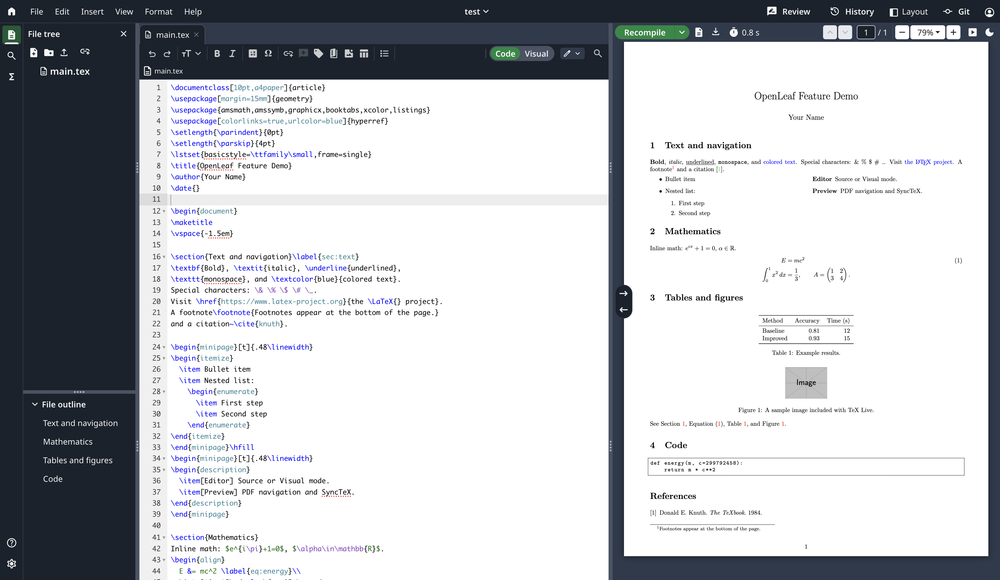

# OpenLeaf

Self-hosted LaTeX editor with an Overleaf-derived interface.

This project is still in early stages. Collaboration is not implemented
yet, but planned.



## Run with Docker

Requires Docker Engine and the Compose plugin. On Linux, from the repository root:

```sh
export OPENLEAF_PUBLIC_URL=http://localhost:3000
export OPENLEAF_DATA_DIR=/var/lib/openleaf
export DOCKER_GID=$(stat -c '%g' /var/run/docker.sock)

sudo install -d -m 0700 -o 1000 -g 1000 "$OPENLEAF_DATA_DIR"
docker pull texlive/texlive:latest
docker compose -f docker/docker-compose.yml up -d --build
```

Open `http://localhost:3000` and register the first account. Further signups are
closed by default. Set `OPENLEAF_ALLOW_SIGNUP=true` to enable them.

For remote access, set `OPENLEAF_PUBLIC_URL` to the browser-facing HTTPS origin
and put a reverse proxy in front of the loopback-bound service. The proxy must
forward WebSocket upgrades for `/collab`. Enable `OPENLEAF_TRUST_PROXY` only when
requests arrive through a trusted proxy.

The data directory must have the same absolute path on the host and inside the
container because compile containers bind-mount host paths. Back it up regularly.
Docker socket access grants administrative authority over the Docker host.

See [docker/docker-compose.yml](docker/docker-compose.yml) for configuration,
including TeX Live images, compile resources, upload limits, and realtime quotas.
Uploads default to 50 MiB per file and 300 MiB per multipart batch or decoded ZIP.
Pin the TeX Live image to a version or digest for reproducible deployments.

## Develop

Requires Node.js 22.18+, pnpm 11.10.0, Git, and local TeX Live with `latexmk`,
`synctex`, `chktex`, and `texcount`. Install Pandoc for document exports.

```sh
corepack enable
pnpm install --frozen-lockfile
pnpm dev
```

Open `http://localhost:5173`. Development uses host TeX Live with shell escape
disabled. Production requires the Docker compile runner.

## License

[AGPL-3.0-or-later](LICENSE). Editor components and styles are adapted from Overleaf.
